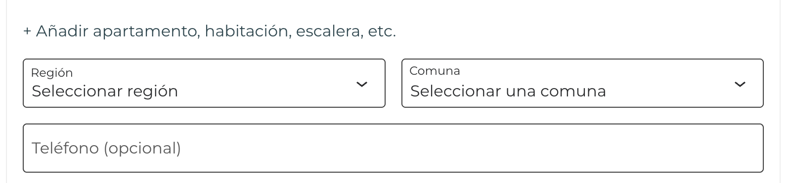

# Regiones y Comunas de Chile

**Contributors:** alvaromoca
**Tags:** woocommerce, chile, regiones, comunas, checkout
**Requires at least:** 6.3
**Tested up to:** 6.8
**Stable tag:** 2.0.3
**Requires PHP:** 8.1
**License:** GPL v2 or later
**License URI:** [https://www.gnu.org/licenses/gpl-2.0.html](https://www.gnu.org/licenses/gpl-2.0.html)

Agrega todas las regiones y comunas de Chile al checkout de WooCommerce con dropdowns dinámicos.

## Descripción

Este plugin agrega todas las regiones y comunas de Chile al checkout de WooCommerce, permitiendo una mejor experiencia para los usuarios chilenos. Incluye funcionalidades para filtrar comunas por región directamente en la página de checkout.

### Características principales

- Agrega todas las regiones y comunas de Chile al checkout de WooCommerce
- Compatible con el checkout clásico y el checkout de bloques
- Permite filtrar comunas por región
- Traduce automáticamente las etiquetas "Región" y "Comuna" en el checkout
- Compatible con HPOS (High-Performance Order Storage) de WooCommerce
- Optimizado para un rendimiento rápido

## Requisitos

- WordPress 6.3 o superior
- WooCommerce 9.0 o superior
- PHP 8.1 o superior

## Instalación

1. Descarga el archivo zip del plugin
2. Ve a tu panel de administración de WordPress > Plugins > Añadir nuevo
3. Haz clic en "Subir plugin" y selecciona el archivo zip descargado
4. Activa el plugin desde la sección de plugins

## Uso

Una vez activado, el plugin funcionará automáticamente en el checkout de WooCommerce. No requiere configuración adicional.

### Dropdowns en el checkout

El plugin reemplaza los campos de texto estándar por menús desplegables (dropdowns) tanto para la región (city) como para la comuna (state) en el checkout de WooCommerce:

Esto permite a los usuarios seleccionar fácilmente su región y luego filtrar las comunas correspondientes a esa región, mejorando significativamente la experiencia de usuario durante el proceso de compra.

### Plugins recomendados para reglas de envío

Este plugin es ideal cuando necesitas configurar reglas de envío específicas por comuna, como por peso del carrito, precio de la compra, etc. Recomendamos los siguientes plugins complementarios:

- **Flexible Shipping**: Para reglas por comuna basadas en precio y peso (funcionalidad básica para peso)
- **WC - APG Envío por peso**: Para reglas avanzadas relacionadas con el peso de los productos

## Compatibilidad

- Compatible con el checkout clásico de WooCommerce
- Compatible con el checkout de bloques de WooCommerce
- Compatible con HPOS (High-Performance Order Storage)

## Soporte

Para soporte técnico o consultas, visita [Estudio MOCA](https://estudiomoca.cl/) o abre un issue en el [repositorio del plugin](https://github.com/Estudio-MOCA/em-regiones-comunas).

## Contribuir

Las contribuciones son bienvenidas. Si deseas contribuir al desarrollo de este plugin, por favor envía un pull request al [repositorio del plugin](https://github.com/Estudio-MOCA/em-regiones-comunas).

## Licencia

Este plugin está licenciado bajo la licencia GPL v2 o posterior.

## Créditos

Desarrollado por Álvaro León [Estudio MOCA](https://estudiomoca.cl/).
